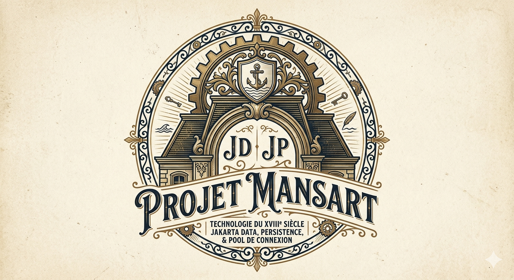

# Mansart

  

Jakarta Data 1.0, Jakarta Transactions 2.0 and a virtual-thread-native JDBC pool for the Vidocq ecosystem.

The name pays homage to **Jules Hardouin-Mansart**, 17th-century architect (Versailles, Invalides,
Place Vendome) — the idea of durable, modular, carefully assembled structures matches the role of
the persistence layer in the stack.

## Sub-projects

| Sub-project | Description |
| --- | --- |
| `mansart-jakarta-data` | **Jakarta Data 1.0** implementation (repositories, pagination, query methods). Direct JDBC backend, pluggable dialects. |
| `mansart-transactions` | **Jakarta Transactions 2.0** transaction manager and CDI/JDBC integration. |
| `mansart-pool`         | **Virtual-thread-native** JDBC connection pool, post-Loom, zero dependencies, optional and standalone. Usable outside Mansart. |

Persistence and the provisional Validation implementation moved to the independent
[Noether repository](https://codefloe.com/Vidocq/noether) on 2026-10-11.
Their artifacts/packages now use `io.vidocq.noether`; they are no longer built
or released by this reactor. Mansart Data remains on its direct JDBC backend;
a Data/JPA bridge is deferred.

## Philosophy (inherited from Vidocq)

- **Strict Java Modules**, no classpath.
- **Class-File API (JEP 484) + APT** to generate `@Repository` implementations and the static metamodel at compile time. No runtime reflection, no dynamic proxies.
- **Zero external dependencies** beyond Jakarta specs. Native JDBC, no Hibernate, no Spring Data, no QueryDSL.
- **Virtual Threads** for all query execution.
- **TDD + Arquillian** for the TCK harness.

## Status

Jakarta Data, the pool and Transactions retain their production behavior.
See [ROADMAP.md](ROADMAP.md) and each retained module's documentation.
Persistence P0–P12 scope, Validation limitations and preserved historical
TCK/benchmark evidence are now documented in
[Noether](https://codefloe.com/Vidocq/noether).
No Persistence implementation or provisional Validation provider remains
in the Mansart reactor.

## Priority dialects

1. **H2** (embedded mode — target for unit tests and in-memory TCK).
2. **PostgreSQL** (reference production target).

Others (MySQL, MariaDB, Oracle, SQL Server, SQLite, DuckDB) will follow once the dialect SPI stabilises.
